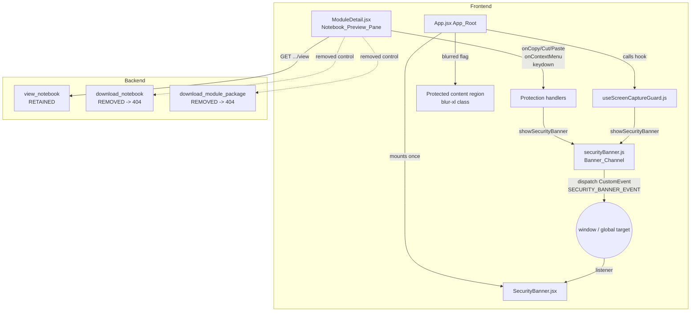

# Design Document

## Overview

This feature ports the display-only content-protection layer from the TypeScript source module (`module-01-react-frontend`) into the plain-JSX `course-ai-platform` frontend, and removes the two content-exfiltration paths (per-notebook `.ipynb` download and module package download) on both the frontend and the FastAPI backend.

The protection is intentionally a **deterrent**, not a guarantee. It makes casual copying, screenshotting, and exporting inconvenient while keeping the notebook HTML fully viewable and the existing learning flow (preview + self-attestation completion) intact. As recorded in the requirements, a web app cannot stop OS capture tools or a phone camera, and some OS capture tools do not fire the browser `blur`/`visibilitychange` events; blurring is therefore best-effort.

### Scope

Four coordinated pieces, plus test coverage:

1. **Banner channel** (`src/lib/securityBanner.js`) — a context-free event bus (`SECURITY_BANNER_EVENT` + `showSecurityBanner(message)`) any code can call.
2. **Security banner** (`src/components/SecurityBanner.jsx`) — a single transient top-of-screen notice, mounted once in `App.jsx`.
3. **Screen capture guard** (`src/hooks/useScreenCaptureGuard.js`) — tracks window active/inactive state, drives a full-app blur, and flags PrintScreen.
4. **Preview-pane protection** (in `src/pages/ModuleDetail.jsx`) — blocks copy/cut/paste, text selection, and the context menu on the rendered notebook HTML; removes the two download controls.
5. **Backend removal** (in `backend/app/routers/modules.py`) — deletes the `download` and `download-package` route handlers so the paths return 404; retains the `view` endpoint.

### Key differences from the source module (why this is a port, not a copy)

The source TS files are a reference for *intent*. The requirements here are stricter, so the ported implementation adds behavior the source lacks:

- The source `securityBanner.ts` does no input validation and assumes `window` exists. Requirement 5 demands string-type validation, a rejection signal to the caller, and safe no-op when no global target exists.
- The source `SecurityBanner.tsx` reads `detail.message` directly and does not guard empty messages or truncate long ones. Requirement 6 demands empty-message ignore (retain current message + timer), 200-char truncation, and a 2800 ms restartable timer.
- The source `useScreenCaptureGuard.ts` dispatches a blur banner on *every* blur and a PrintScreen banner on *every* PrintScreen keyup. Requirements 3.8 and 4.3 demand de-duplication (no repeat banner while already blurred / while the PrintScreen notice is showing), and Requirement 4.5 demands safe handling when key data is absent.

### Target environment constraints

- **React 19** + **Vite**, **plain JSX** (no TypeScript), **Tailwind v4**. No state library, no React context for the banner (per steering + Requirement 5).
- **Testing:** Vitest + `@testing-library/react` + jsdom. `fast-check` is used for the round-trip property test and **must be added** as a dev dependency (it is not currently in `frontend/package.json`).
- **Lint:** the frontend uses `oxlint`. Requirement 9.5 ("unused import fails the build") is satisfied by the Vite build together with the lint step; the design removes the import outright so no unused-import remains.
- **Backend:** FastAPI, tested with `pytest` + `hypothesis` under `backend/tests/`.

## Architecture

### Component and data-flow diagram



### Design decisions and rationale

- **Event bus over React context (Requirement 5).** The banner channel dispatches a browser `CustomEvent` on `window`, so protection code in a hook, a component handler, or any module can surface a notice without threading a provider. This matches the steering rule "do not introduce Context providers" and the source module's approach.
- **Single banner listener at the root (Requirement 7).** Mounting `SecurityBanner` once in `App.jsx` (outside `<Routes>`) guarantees exactly one listener regardless of the active route, so a dispatched event never double-fires or re-mounts on navigation.
- **Blur applied at the App root, not per-page (Requirement 3.5/3.7).** The `blurred` flag from the hook toggles a Tailwind `blur-xl` (≥ 8px) class on the wrapper that contains all protected content, so the whole app obscures on inactivity with a single source of truth.
- **Preview protection lives on the pane element (Requirements 1, 2).** Handlers (`onCopy/onCut/onPaste/onContextMenu/onKeyDown`) and the `user-select: none` style are attached to the `dangerouslySetInnerHTML` container so they cover dynamically inserted notebook HTML and do not affect the rest of the UI (form inputs, textareas remain usable for completion).
- **Backend removal by deleting handlers (Requirements 8, 9).** Removing the route decorators/functions makes FastAPI return 404 for the path on GET and for other methods (no route registered), which is exactly the required behavior, and avoids leaving dead code paths.

## Components and Interfaces

### 1. `src/lib/securityBanner.js` — Banner_Channel

```js
// Event name is a module-level constant (stable across imports within a session).
export const SECURITY_BANNER_EVENT = "app:security-banner";

/**
 * Dispatch a security banner notice.
 * @param {string} message
 * @returns {boolean} true if an event was dispatched, false if input was rejected
 *                    or no global target was available.
 */
export function showSecurityBanner(message) { /* ... */ }
```

Behavior:
- Validates `typeof message === "string"`; if not, returns `false` and dispatches nothing (Requirement 5.4). The boolean return is the "indication to the caller that the input was rejected."
- Resolves the global target defensively (`window` / `globalThis`); if none has `dispatchEvent`, returns `false` without throwing (Requirement 5.5).
- Otherwise dispatches exactly one `CustomEvent(SECURITY_BANNER_EVENT, { detail: { message } })` and returns `true` (Requirements 5.2, 5.3). The message is placed in `detail.message` verbatim — no trimming/encoding.

Note: `showSecurityBanner` itself does **not** truncate or reject long strings (a 6000-char string is still dispatched byte-for-byte, satisfying the round-trip property in Requirement 11.5). Length-based *display* rules (200-char cap) live in the banner component.

### 2. `src/components/SecurityBanner.jsx` — Security_Banner

Props: none. Internal state: `message` (string | null), a `timeoutRef`.

Behavior:
- On mount, registers one listener for `SECURITY_BANNER_EVENT`; on unmount removes it and clears the pending timer (Requirements 6.7, 7.4).
- On event: reads `e.detail?.message`. If missing/empty → ignore, keep current message, do **not** restart timer (Requirements 6.2, 7.5). If length > 200 → display `message.slice(0, 200)` (Requirement 6.3). Otherwise display as-is (Requirement 6.1).
- On any accepted message: set `message`, clear any existing timer, start a fresh `setTimeout(2800ms)` that sets `message` back to `null` (Requirements 6.5, 6.6).
- Rendering: when `message` is non-null the banner is visible (`data-testid="security-banner"`, `role="alert"`, translated on-screen); when null it is hidden (translated off-screen / not visible) (Requirements 6.4, 6.5). Styling uses the platform's CSS-variable tokens (ink/paper/brass palette), not the source module's tokens.

### 3. `src/hooks/useScreenCaptureGuard.js` — Screen_Capture_Guard

```js
/** @returns {boolean} blurred — true while the window is inactive/hidden. */
export function useScreenCaptureGuard() { /* ... */ }
```

State: `blurred` (boolean, initial `false`). Uses a ref to track whether the PrintScreen notice is currently active, so it can de-duplicate.

Event wiring (added on mount, removed on unmount):
- `window` `blur` → set `blurred` true; if it was previously false, dispatch the blur banner once (Requirements 3.1, 3.6, 3.8).
- `window` `focus` → set `blurred` false (Requirement 3.3).
- `document` `visibilitychange` → if `document.hidden` behaves like blur, else like focus (Requirements 3.2, 3.4).
- `window` `keyup` → if key data is absent (`e.key == null`) do nothing (Requirement 4.5); if `e.key === "PrintScreen"` dispatch the PrintScreen banner unless one is already showing (Requirements 4.1, 4.3); any other key dispatches nothing (Requirement 4.2).

De-duplication detail: the transition from `false → true` is what triggers the blur banner (Requirement 3.8 — a second blur while already blurred does nothing). For PrintScreen (Requirement 4.3), the hook tracks a "notice active" ref set on dispatch and cleared after the standard dismiss interval (2800 ms, matching the banner), so repeated PrintScreen keyups within that window do not re-dispatch (Requirement 4.4).

### 4. `src/pages/ModuleDetail.jsx` — Notebook_Preview_Pane changes

- **Preview container** (the `dangerouslySetInnerHTML` wrapper) gains:
  - `style` / class with `user-select: none` and vendor prefixes applied to 100% of content (Requirement 2.1).
  - `onCopy`, `onCut`, `onPaste` handlers → `e.preventDefault()` + one banner (Requirements 1.5, 1.6).
  - `onKeyDown` handler → detect Ctrl/Meta+C/X/V (case-insensitive) and Shift+Insert → `preventDefault()` + one banner (Requirements 1.1–1.4). The banner dispatch is wrapped so a dispatch failure never skips `preventDefault` (Requirement 1.7).
  - `onContextMenu` → `preventDefault()` + one banner per event (Requirements 2.3, 2.4).
  - Select-All (Ctrl/Meta+A) handled so no content is selected; combined with `user-select:none`, selection gestures yield zero selected characters (Requirement 2.2).
- **Removed controls:** the "download unlocked package" button in the header and the "download .ipynb" button in `NotebookRow` are deleted (Requirements 8.1, 9.1). The `import { downloadFile } from "../download"` line and all references are removed (Requirements 9.4, 9.5). Unused `lucide-react` icons (`Download`, `Package`) are removed from the import.
- **Preserved:** `preview` load via the view endpoint, error handling, and the self-attestation completion `submit` flow are unchanged (Requirement 10).

Handler helper (shared logic):

```js
function blockAndNotify(e, message) {
  e.preventDefault();
  try { showSecurityBanner(message); } catch { /* banner failure never un-blocks */ }
}
```

### 5. `src/App.jsx` — App_Root changes

- Import and render `<SecurityBanner />` exactly once, above the routed content (Requirement 7.1).
- Call `useScreenCaptureGuard()` and wrap the protected content region in a div whose class includes `blur-xl` when `blurred` is true and transitions the filter (Requirements 3.5, 3.7). The banner sits outside the blurred region so the notice stays legible.

### 6. `backend/app/routers/modules.py` — Modules_Router changes

- Delete `download_notebook` (the `GET /{slug}/notebook/{filename}/download` handler) → path now 404 for any slug/filename, no `.ipynb` body; no other method returns content (Requirements 8.2, 8.3).
- Delete `download_module_package` (the `GET /{slug}/download-package` handler) → path now 404 for any method (Requirements 9.2, 9.3).
- Remove now-unused imports (`io`, `zipfile`, `Path`, `FileResponse`, `StreamingResponse`) if not used elsewhere.
- Keep `view_notebook` unchanged → unlocked notebook returns 200 + HTML (Requirements 8.4, 10.1).

## Data Models

This feature introduces no persistent data models. The only structured data is the transient banner event payload.

### Banner event payload

| Field            | Type              | Notes                                                                 |
|------------------|-------------------|-----------------------------------------------------------------------|
| event type       | string constant   | `SECURITY_BANNER_EVENT` = `"app:security-banner"`                     |
| `detail.message` | string            | The exact message passed to `showSecurityBanner`, verbatim (no edits) |

### Guard state

| Name      | Type    | Source                     | Consumer                       |
|-----------|---------|----------------------------|--------------------------------|
| `blurred` | boolean | `useScreenCaptureGuard()`  | `App.jsx` blur wrapper class   |

### Standard messages (constants)

| Constant                | Used for                              | Requirement |
|-------------------------|---------------------------------------|-------------|
| copy/cut/paste blocked  | keyboard + native clipboard events    | 1.6         |
| context menu blocked    | right-click                           | 2.4         |
| window inactive / blur  | blur / tab hidden                     | 3.6         |
| screenshots unsupported | PrintScreen keyup                     | 4.1         |

### Dismiss / timing constants

| Constant              | Value    | Requirement       |
|-----------------------|----------|-------------------|
| banner dismiss interval | 2800 ms | 6.5, 6.6          |
| display truncation cap  | 200 chars | 6.3             |

## Correctness Properties

*A property is a characteristic or behavior that should hold true across all valid executions of a system — essentially, a formal statement about what the system should do. Properties serve as the bridge between human-readable specifications and machine-verifiable correctness guarantees.*

Most of this feature is UI interaction, state transitions, rendering, and backend route removal — those acceptance criteria are best pinned with example, edge-case, and integration tests (see Testing Strategy). After the prework analysis and property reflection, exactly **one** acceptance criterion expresses a universal property over a large input space that is high-value to test with generated inputs: the banner channel's message round-trip.

### Property 1: Banner-channel message round-trip is byte-for-byte identical

*For any* string `s` of length 0 to 10000 characters passed to `showSecurityBanner(s)`, a listener registered for `SECURITY_BANNER_EVENT` SHALL receive, in `event.detail.message`, a value strictly equal to `s` — with no truncation, trimming, encoding, or other modification.

**Validates: Requirements 5.3, 11.5**

## Error Handling

- **Banner dispatch failure during a blocked action (Requirement 1.7).** Every clipboard/context-menu handler calls `e.preventDefault()` *before* attempting to dispatch a banner, and the dispatch is wrapped in `try/catch`. If `showSecurityBanner` throws, the block still stands and the error is swallowed so it never reaches the user or un-blocks the action.
- **Invalid banner input (Requirement 5.4).** `showSecurityBanner` type-checks its argument; non-strings (null, undefined, number, object, array, boolean) are rejected with a `false` return and no event dispatch. Existing listeners are untouched.
- **No global event target (Requirement 5.5).** `showSecurityBanner` resolves the global target defensively and returns `false` (no throw) when no `dispatchEvent`-capable target exists, so it is safe to call in non-browser/SSR/test contexts.
- **Empty or missing banner payload (Requirements 6.2, 7.5).** The banner listener ignores events whose `detail.message` is missing or empty: the currently displayed message and its dismiss timer are left unchanged.
- **Over-length display message (Requirement 6.3).** The banner truncates display to the first 200 characters; the channel still carried the full string (Property 1), only the on-screen render is capped.
- **Absent key data on keyup (Requirement 4.5).** The guard checks `e.key` before comparing; if it is null/undefined it dispatches nothing and does not throw.
- **View endpoint error or timeout (Requirement 10.2).** `ModuleDetail` preview loading catches API errors and shows an error indication ("content could not be loaded") while preserving the previous state, rendering no partial HTML.
- **Backend removed routes (Requirements 8.2, 8.3, 9.2, 9.3).** With the handlers deleted, FastAPI has no matching route, so all methods on those paths return 404 with no notebook/package body.
- **Component unmount (Requirements 6.7, 7.4).** The banner and the guard hook remove their listeners and clear pending timers on unmount, preventing duplicate listeners and post-unmount state updates.

## Testing Strategy

The frontend suite runs under **Vitest + @testing-library/react + jsdom**; the backend suite under **pytest**. `fast-check` must be added to `frontend/package.json` dev dependencies for the property test.

### Property-based tests

PBT applies to exactly one behavior in this feature (see Correctness Properties). All other criteria use example, edge-case, integration, or smoke tests, because they are UI interactions, state transitions, rendering assertions, or route-removal checks whose behavior does not vary meaningfully across a large input space.

- **Property 1 — banner-channel round-trip.** Implemented as a single `fast-check` property test over `fc.string({ maxLength: 10000 })` (including the empty string), minimum **100** iterations. Register a `SECURITY_BANNER_EVENT` listener, call `showSecurityBanner(s)`, and assert the received `detail.message` is strictly equal (`===`) to `s`.
  - Tag: `// Feature: notebook-content-protection, Property 1: For any string s (len 0..10000), showSecurityBanner round-trips s byte-for-byte to the listener`
  - Config: `fc.assert(fc.property(...), { numRuns: 100 })`.
  - File: `frontend/src/lib/securityBanner.property.test.js`.

### Example and edge-case tests (frontend)

`securityBanner.js`:
- Constant `SECURITY_BANNER_EVENT` is a non-empty string and identical across imports (5.1).
- Valid string dispatches exactly one event (5.2).
- Non-string inputs rejected, no dispatch, returns false (5.4 — edge).
- No global target → no throw, returns false (5.5 — edge).

`SecurityBanner.jsx` (fake timers):
- Displays received message; visible while shown (6.1, 6.4).
- Empty/missing message ignored, current message + timer retained (6.2, 7.5 — edge).
- Message > 200 chars truncated to first 200; test 250-char and 10000-char and a unicode boundary (6.3 — edge).
- Hides after 2800 ms with no newer message (6.5 — mandated by 11.4).
- Newer message replaces text and restarts the 2800 ms timer (6.6).
- Unmount removes listener and cancels timer (6.7, 7.4).

`useScreenCaptureGuard.js` (renderHook):
- `blur` → blurred true; `focus` → blurred false (3.1, 3.3 — mandated by 11.1).
- `visibilitychange` hidden → true; visible → false (3.2, 3.4 — mandated by 11.2).
- false→true transition dispatches exactly one blur banner; repeated blur while already blurred stays true with no extra banner (3.6, 3.8 — edge/idempotence).
- true→false transition (3.7).
- `keyup` PrintScreen → exactly one banner; other keys → zero (4.1, 4.2 — mandated by 11.3).
- Repeated PrintScreen within the dismiss window → no additional banner (4.3 — edge).
- PrintScreen banner persists for the dismiss interval (4.4).
- keyup with absent key data → no banner, no throw (4.5 — edge).

`ModuleDetail.jsx` preview protection (render + fireEvent):
- Ctrl/Meta+C/X/V (case-insensitive) and Shift+Insert keydown → preventDefault, one banner (1.1–1.4, 1.6).
- Native copy/cut/paste events → preventDefault (1.5).
- Banner dispatch throwing still prevents default (1.7 — edge).
- Container has `user-select: none` + vendor prefixes (2.1).
- Select-All prevented / zero selection (2.2 — edge).
- contextmenu → preventDefault + exactly one banner per event (2.3, 2.4).
- No `.ipynb` download control and no package-download control rendered (8.1, 9.1).
- Preview loads and renders returned HTML (10.1); view error shows error indication with no partial render (10.2 — edge); self-attestation completion still records completion (10.3).

`App.jsx`:
- Exactly one `SecurityBanner` in the tree (7.1); it persists across route transitions (7.2); an event from any component shows within 500 ms (7.3).
- Blur wrapper gets the `blur-xl` (≥ 8px) class when blurred and removes it when unblurred (3.5, 3.7).

### Integration tests (backend, pytest + FastAPI TestClient)

- `GET /api/modules/{slug}/notebook/{filename}/download` → 404, no `.ipynb` body, for a couple of slug/filename values (8.2).
- Non-GET methods on the download path → no `.ipynb` content (8.3).
- `GET /api/modules/{slug}/download-package` → 404 (9.2); non-GET → 404 (9.3).
- `GET /api/modules/{slug}/notebook/{filename}/view` for an unlocked notebook → 200 + HTML (8.4, 10.1).

### Smoke / build checks

- Frontend builds and lints cleanly with the `download` helper import removed from `ModuleDetail.jsx`; no unused-import remains (9.4, 9.5, 10.4).
- The full frontend suite exits non-zero and names the failing test on failure — provided by Vitest's default runner (11.6).

### Testing balance

Unit/example tests carry the bulk of coverage here because the feature is interaction- and rendering-heavy. The single property test guards the one universal invariant (the channel never mangles a message), which is the highest-risk correctness concern given arbitrary user-facing notice strings. Backend route removal is verified by a few integration examples rather than properties, since a removed route returns 404 identically for all inputs.
